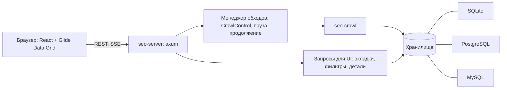

# Интерфейс seo-spider: проект

Состояние: проект, согласован 22.10.2026. Реализации ещё нет.

## Решения

| Вопрос | Решение |
|---|---|
| Где живёт интерфейс | Веб-UI, который отдаёт сам бинарник: `seo-spider ui` поднимает локальный сервер и открывает браузер. Тот же UI работает удалённо: обход на сервере (umbrel), браузер на Маке. Обёртка в Tauri (.app) — позже, поверх того же фронтенда. |
| Фронтенд | React + Glide Data Grid: таблица на canvas тянет миллионы строк, колонки, сортировка и выделение есть из коробки. |
| Первая версия | Запуск и прогресс; все существующие настройки; таблицы вкладок с фильтрами и счётчиками; панель деталей URL; новые вкладки (разметка, своё извлечение, JavaScript, почти дубли) и сводка проблем. |
| Продолжение обхода | Полное: прерванный обход продолжается после перезапуска программы. |
| Хранилище | SQLite по умолчанию плюс внешние БД: PostgreSQL и MySQL. |

Каркас главного окна: сверху URL, пресет, настройки, пауза и стоп, строка прогресса; слева вкладки со счётчиками; в центре таблица URL с быстрыми фильтрами и поиском; снизу панель выбранного URL (детали, входящие, исходящие, проблемы, разметка, сырой и отрисованный документ, сниппет).

## Архитектура

- Новый крейт `seo-server` (axum, tokio). Подкоманда `seo-spider ui [--bind 127.0.0.1:7070] [--db …]`.
- Собранный фронтенд (Vite) встраивается в бинарник (`rust-embed`): один файл, без отдельной установки. В разработке сервер проксирует на dev-сервер Vite.
- Прогресс идёт через SSE из `CrawlControl::progress` (watch-канал, 4 раза в секунду).
- Таблицы читаются страницами с сервера: сортировка, фильтры и поиск выполняет БД, а не браузер. Glide Data Grid запрашивает видимое окно строк.

## Менеджер обходов

- Старт: конфиг (пресет → TOML → правки из формы) → `crawl_with` в фоне. Одновременно идёт один обход на процесс; список обходов в базе.
- Пауза — новый флаг в `CrawlControl`: диспетчер перестаёт выдавать запросы, текущие доходят до конца. Продолжение снимает флаг.
- Стоп — уже есть: ждущие запросы снимаются сразу, повторный сигнал завершает процесс.
- Состояние обхода в таблице `crawls`: `running`, `paused`, `stopped`, `finished`, `interrupted`. Обход, который был `running` при старте программы, считается прерванным и предлагается к продолжению.

## Продолжение обхода

Очередь не пишется в базу во время обхода: её можно восстановить из того, что уже записано.

1. Известные URL — все строки `urls` обхода; у записанных страниц есть глубина.
2. Ссылки каждой записанной страницы лежат в её фактах (сырых и отрисованных). Прогон «обнаружения» по фактам, с теми же правилами (`Scope`, фильтры, nofollow, ресурсы, внешние), даёт всё найденное. Найденное минус записанное — очередь, глубина = глубина родителя + 1.
3. robots.txt и sitemap запрашиваются заново, как при старте.
4. Конфиг берётся из `crawls.config`, счётчики сводки — из базы.

Цена: ноль во время обхода, при продолжении — один проход по фактам (на 100k страниц секунды, как фаза проверок). Порядок очереди может отличаться от исходного, на результат это не влияет.

Как сделано (`crates/seo-crawl/src/resume.rs`):

- Записанные URL становятся известными первыми, со своими id, и занимают свою долю бюджетов. Какой бюджет занимал URL, не хранится: внутренний ответ 2xx не-HTML считается ресурсом.
- Новые URL получают id после последнего в файле: между частями обхода в файл мог записаться другой обход.
- Страница, у которой ответ записан, а факты нет (обрыв между двумя записями одной пачки), запрашивается снова под своим id (`INSERT OR REPLACE` в `urls`).
- Закрыто ли что-то robots.txt, прерванный обход не записал: это решается заново по свежему robots.txt.
- Обход закрывается как один: глубины и состояния по всем URL, затем проверки.
- `crawls.stopped` отличает остановленный обход от законченного; продолжить можно прерванный и остановленный, а законченный — с бо́льшим `max_urls` из CLI.

Замеры: обход стенда на 100 тыс. страниц (210 тыс. URL) восстанавливается за 4,5 с, пик памяти 514 МБ. Остановленный на 10 из 21 URL и продолженный обход тестового сайта, как и убитый `kill -9` посреди работы, совпадают с цельным: те же URL, глубины, отметки sitemap и robots, коды, факты и проблемы.

## Авто-режим JavaScript

Пресет «Авто» (по умолчанию в UI) сам решает, нужен ли рендер (`crates/seo-crawl/src/auto.rs`). До обхода главная и по странице из каждого раздела, на который она ссылается (на уровень глубже, если есть: карточка товара, а не каталог), читаются двумя способами: как HTML от сервера и после JavaScript. JS важен, если хоть на одной странице он меняет то, что читает SEO-обход: текст (больше на пятую часть и 30 слов), ссылки (внутренняя ссылка, которой нет в HTML ни одной из пробных страниц), title, H1, description, canonical, noindex. Тогда рендерится весь обход, иначе рендер выключается. Решение с причиной и пробными страницами хранится в настройках обхода (`render_decision`), продолженный обход не спрашивает заново; в UI — состояние «Проверка JS» и полоса над обзором.

## Хранилище

`seo-store` — один код хранилища поверх трейта `Backend` (`crates/seo-store/src/sql.rs`): выполнить оператор, потоково прочитать строки, вставить много строк в таблицу, обновить колонки многих строк, транзакции. Три реализации:

- SQLite (`rusqlite`) — по умолчанию: файл обхода, без серверов. Подготовленные вставки в одной транзакции.
- PostgreSQL (`tokio-postgres` + rustls): массовая запись `COPY … FROM STDIN BINARY`, массовое обновление через временную таблицу. Соединение крутится на своём потоке со своим маленьким runtime, а вызовы хранилища выполняют его future обычным `block_on`, поэтому работают из любого потока, в том числе из асинхронных задач обхода (у крейта `postgres` там падает вложенный runtime). Факты и тела документов — `bytea` без повторного сжатия (`STORAGE EXTERNAL`): они уже в zstd.
- MySQL (`mysql`, синхронный, rustls): многострочные подготовленные `INSERT`, сколько позволяют лимит параметров и половина `max_allowed_packet`; число строк — степень двойки, чтобы операторы переиспользовались. Колонки с двоичной сортировкой (`utf8mb4_bin`): сравнения как в SQLite и PostgreSQL, без нечувствительности к регистру и ударениям.

SQL пишется один раз: стандартный, параметры `?1`, `?2`; `translate` превращает их в `$1` для PostgreSQL и в позиционные `?` для MySQL (где же `length` → `char_length`). Непереносимые места переписаны: `count(CASE …)` вместо `sum` логического выражения, `CASE` вместо `||` для классов статусов, среднее считается в Rust, поиск `lower(url) LIKE … ESCAPE '!'`. Чтение — строки из значений `Value`, которые MySQL отдаёт байтами, разбираются по запрошенному типу; `NUMERIC` из PostgreSQL (суммы) разбирается из двоичного вида.

Схема одна, типы по диалекту; SQLite сохраняет прежнюю схему своих файлов (внешние ключи, уникальный URL в обходе), серверы полагаются на краулер и обходятся без того, что только замедлило бы массовую запись. Индексы по ссылкам строятся по запросу; в PostgreSQL — по `md5(to_url)` (длинный URL не влезает в btree), в MySQL — по префиксу.

Подключение: `--db postgres://…`, `--db mysql://…` или путь к файлу. Пароль — из адреса, `SEO_SPIDER_DB_PASSWORD` или `PGPASSWORD`/`MYSQL_PWD`; в выводе и логах адрес печатается с `***`. Сервер UI держит до четырёх соединений на чтение.

Проверено: тесты хранилища и продолжения обхода идут на всех трёх базах (`SEO_SPIDER_TEST_POSTGRES`, `SEO_SPIDER_TEST_MYSQL`); тестовый сайт, обойдённый в три базы, даёт одинаковые выгрузки всех вкладок; API сервера UI поверх PostgreSQL и MySQL — обход, остановка, продолжение, вкладки, детали, выгрузки. Замеры — в README.

Для таблиц UI нужны колонки, по которым фильтруют и сортируют, а не только JSON фактов. В `facts` уже есть title, description, h1, canonical, robots, word_count, text_hash, links. Добавить: длины title и description, число H1, индексируемость и её причину, число входящих ссылок (после обхода).

## Проблемы и фильтры

Фильтр вкладки в SF — почти всегда наша проверка: «Title: отсутствует» — это `title_missing`, «Длиннее 60 символов» — `title_too_long`. Поэтому:

- Вкладка = категория каталога, фильтр = код проверки плюс общие фильтры (все, HTML, по классу ответа, индексируемые и нет).
- Счётчик фильтра = `SELECT code, count(*) FROM issues … GROUP BY code`, индекс уже есть.
- Постраничные проверки (`check_page`) переезжают в обход: страница проверяется в воркере сразу после извлечения, проблемы пишутся вместе с ней. Тогда счётчики живут во время обхода, как в SF. Проверки уровня сайта (дубли, почти дубли, сироты, цепочки) — по-прежнему в конце, «анализ обхода».

## Входящие ссылки

Сейчас строки ссылок по умолчанию не пишутся (на 5,7 млн ссылок это 10 с из 25), а экспорт считает входящие по фактам. Панели деталей нужны входящие для любого URL сразу.

Предложение: компактная таблица `edges (from_id, to_id, flags, anchor)` с целочисленными id. Очередь знает id цели в момент обнаружения, поэтому текст URL в каждой ссылке не нужен, и строка выходит в несколько раз меньше нынешней. Анкоры хранить только при включённой опции или читать из фактов источника при открытии панели. Цену измерить на 100k-бенче до решения.

## API сервера

| Метод | Что делает |
|---|---|
| `GET /api/presets`, `/api/presets/{name}/config` | пресеты с пояснениями; настройки пресета целиком |
| `GET /api/config/schema` | JSON Schema настроек (`schemars`), по ней строится форма |
| `GET /api/crawls` | список обходов: URL, дата, состояние, счётчики |
| `POST /api/crawls` | новый обход: адрес, пресет и JSON merge patch поверх пресета |
| `POST /api/crawls/{id}/pause`, `/resume`, `/stop` | управление идущим обходом |
| `POST /api/crawls/{id}/continue` | продолжить прерванный или остановленный обход; `{max_urls}` поднимает лимит |
| `GET /api/crawls/{id}/events` | SSE с прогрессом, четыре раза в секунду |
| `GET /api/crawls/{id}/overview` | счётчики для графиков обзора |
| `GET /api/crawls/{id}/issues` | найденные проблемы: сколько URL, важность, вкладка |
| `GET /api/crawls/{id}/tabs` | вкладки: колонки, фильтры со счётчиками |
| `GET /api/crawls/{id}/tabs/{tab}/rows?filter=&q=&sort=&desc=&offset=&limit=` | строки вкладки: ячейки в порядке колонок |
| `GET /api/crawls/{id}/tabs/{tab}/export.csv?filter=&q=&sort=&desc=` | вкладка в CSV с теми же фильтром, поиском и сортировкой |
| `GET /api/crawls/{id}/export.xlsx` | весь обход книгой Excel, как `seo-spider export` |
| `GET /api/urls/{id}` | детали: ответ и заголовки, факты, проблемы, рендер, своё извлечение |

Позже: входящие и исходящие ссылки URL, сохранённый документ.

Вкладки описаны на сервере (`crates/seo-server/src/tabs.rs`): область URL, встроенные фильтры, проверки каталога по категориям и колонки с типом отображения. UI рисует любую вкладку по этому описанию; фильтр по проблеме показывает все URL с ней, какой бы ни была область вкладки.

## Настройки в UI

Все настройки `CrawlConfig` попадают в форму без ручной синхронизации:

- `schemars` выводит JSON Schema из структур конфига; комментарии к полям становятся описаниями.
- Фронтенд рисует форму по схеме, разделы — по вложенным структурам: обход, HTTP, объём скачивания, извлечение, рендер, хранение, своё извлечение, проверки.
- Русские подписи — словарь во фронтенде по пути поля; без перевода показывается имя поля и описание из схемы.
- Выбранный пресет — основа, форма показывает отличия от него и возвращает поле к значению пресета. На сервер уходит JSON merge patch поверх пресета: `null` убирает значение (так выключается рендер у пресета «SEO + JS»).
- Смена пресета на пресет без рендера сбрасывает настройки рендера, чтобы введённые потоки не включили его обратно.
- Лимит URL и потоки рендера в строке запуска — те же поля, что в форме.
- Пока нет: сохранить конфиг в TOML и загрузить обратно.

## Экраны v1

1. Старт: URL, список URL или sitemap; пресет с пояснением, что он скачивает; настройки; недавние обходы, прерванные — с кнопкой «Продолжить».
2. Рабочая область (каркас выше): вкладки и фильтры, таблица с выбором колонок, поиск по адресу, панель деталей.
3. Сводка проблем: по важности и вкладкам, с описаниями из каталога; клик открывает отфильтрованную таблицу.
4. Вкладки v1: внутренние, внешние, коды ответов, URL, title, description, H1 и H2, контент (точные и почти дубли), изображения, canonical, hreflang, директивы, ссылки, JavaScript, разметка, своё извлечение, проблемы.

## Безопасность удалённого режима

- По умолчанию сервер слушает только 127.0.0.1.
- `--bind` на внешний адрес требует токен: печатается при старте и передаётся заголовком.
- Учётные данные внешних БД в UI не показываются и в API не возвращаются.

## Этапы

1. Ядро для UI: пауза; постраничные проверки во время обхода; колонки для фильтров; `seo-server` с API чтения и SSE; каркас React с таблицей «Внутренние». Сделано.
2. Все вкладки и фильтры, панель деталей, форма настроек по схеме, сводка проблем, экспорт из UI. Сделано, кроме TOML в форме, выбора колонок и входящих ссылок в панели деталей.
3. Продолжение прерванного обхода (очередь из фактов). Сделано: `seo-spider continue`, `POST /api/crawls/{id}/continue`, кнопка «Продолжить» в UI.
4. Трейт хранилища, затем PostgreSQL и MySQL. Сделано: `--db postgres://…`, `--db mysql://…`.
5. Позже: Tauri (.app), сравнение обходов, визуализация структуры сайта, расписание.

## Открытые вопросы

- Зачем внешняя БД: общий доступ команды, объёмы больше SQLite, отчёты в BI? От этого зависят авторизация в UI и то, нужны ли несколько обходов одновременно.
- Таблица `edges`: писать всегда или только при запуске из UI. Решать по замеру на 100k-бенче.
